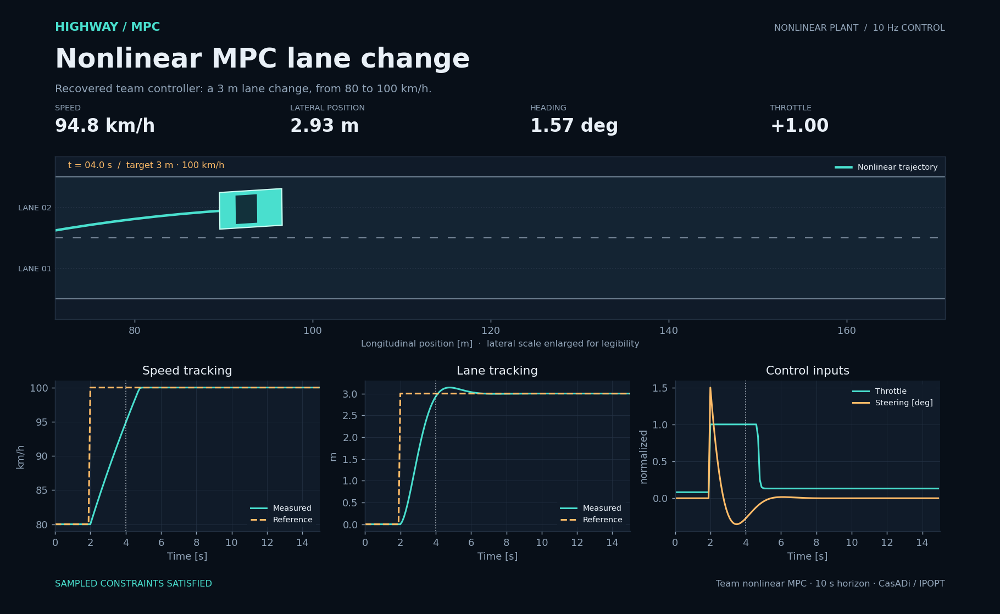

# Highway Model Predictive Control

Highway lane changes, cruise control, and overtaking with a nonlinear vehicle model and constrained MPC. An EPFL ME-425 team project, recovered from the original development branches and reorganized for reproducible simulations.



## Watch the car simulation

Open **[docs/replay.html](docs/replay.html)** in Chrome, Safari, or Firefox. The replay works offline, with no installation or server. On GitHub, download the repository first; the file view shows HTML source.

1. Choose **Nonlinear MPC lane change** or **Nonlinear MPC with a lead car**.
2. Press **Play**. Use **↺** to restart, the slider to seek, or the speed menu to change playback speed.
3. Record that browser window with your preferred screen recorder. This repository contains no recorded video.

The replay uses trajectories computed by the recovered team's MATLAB controllers. It displays vehicle motion and telemetry; it does not solve MPC in the browser. Four scenarios are included: nonlinear lane change, nonlinear avoidance/overtaking, linear tracking, and offset-free tracking.

## Run the simulation in MATLAB

Start MATLAB in the repository root:

```matlab
addpath('car_project');
result = run_project('nonlinear-tracking');
```

The MATLAB visualization opens with a **Start** button. For the overtaking scenario:

```matlab
result = run_project('nonlinear-avoidance');
```

Both require **CasADi for MATLAB**, including IPOPT. In the prepared local workspace, dependencies are already available under the ignored `.dependencies/` folder. They are intentionally excluded from the GitHub ZIP.

For a fresh clone, download the appropriate MATLAB package from the [official CasADi installation page](https://web.casadi.org/get/), extract it, and add its folder to MATLAB's path:

```matlab
addpath('/path/to/casadi'); % folder containing +casadi and casadiMEX
addpath('car_project');
result = run_project('nonlinear-tracking');
```

The tested package was CasADi 3.7.2, Apple Silicon, with MATLAB R2025b. Other platforms need their matching CasADi package.

For linear tracking and the offset-free controller, also add [YALMIP](https://github.com/yalmip/YALMIP) and [MPT3](https://www.mpt3.org/) to MATLAB's path. Install Optimization Toolbox for `quadprog` and `linprog`, or use an available Gurobi installation. Gurobi is selected when present; otherwise the controllers use `quadprog`.

```matlab
result = run_project('tracking');
result = run_project('offset-free');
```

Use a fresh MATLAB session if switching from another project that defines a class named `Car` or `NmpcControl`. Do not add the whole repository with `genpath`; `setup_project` selects the appropriate controller folder.

## Repository layout

```text
car_project/
  common/                 Shared vehicle model, simulator, solver helpers
  deliverables/
    01-dynamics/
    02-linearization/
    03-tracking/
    04-offset-free/
    05-tube-mpc/          Recovered experimental work; see status below
    06-nonlinear-tracking/
    07-nonlinear-avoidance/
  tests/                  MATLAB regression suite
  visualization/          Replay template
  run_project.m           Main entry point
  build_showcase.m        Regenerate replay data and HTML
docs/
  replay.html             Offline interactive car simulation
  data/                   Computed trajectories and metrics
  assets/                 Static simulation previews
  source-manifest.json    Exact upstream commits and file hashes
archive/                  Original branch snapshots and local starter files
scripts/                  Static preview rendering and replay checks
```

The `__MACOSX`, `._*`, and `.DS_Store` files were macOS archive metadata, not project implementations. They are excluded.

## Verification and scope

The six MATLAB regression tests pass on the prepared workspace. They cover model linearization, the Riccati helper, dynamics, both nonlinear controllers, linear tracking, offset-free tracking, input/state limits, and the avoidance ellipse. All four showcased 15-second scenarios complete successfully with no sampled constraint violation.

| Scenario | Final lateral error | Final speed error |
|---|---:|---:|
| Nonlinear tracking | < 0.001 m | < 0.001 km/h |
| Nonlinear avoidance/overtaking | < 0.001 m | < 0.001 km/h |
| Linear tracking | < 0.001 m | < 0.001 km/h |
| Offset-free tracking | 0.0011 m | 0.0109 km/h |

The nonlinear avoidance run satisfies the sampled separation condition `(Δx/12)^2 + (Δy/3)^2 >= 1`, passes the lead vehicle, and returns toward the original lane. These are simulated results, not a general safety or recursive-feasibility proof. Road graphics enlarge the lateral scale for legibility.

**Tube MPC status:** the latest recovered Part 5 code and saved `.fig` plots are preserved. Its state/error dynamics and saved-set interfaces need further review; it is not included in the verified demos. `run_project('tube-mpc')` reports that status explicitly. See [cleanup and validation notes](docs/NOTES.md).

```matlab
results = runtests('car_project/tests');
assertSuccess(results);

% Recompute the nonlinear showcase:
build_showcase;

% Include linear tracking and estimation as well:
build_showcase(true);
```

Optional static previews and replay JavaScript checks:

```sh
python3 -m pip install -r requirements-visuals.txt
python3 scripts/render_assets.py
node scripts/check_replay.mjs
```

The JavaScript checks exercise replay data and playback handlers in a small test harness. A real browser layout test was not available in the cleanup environment.

## Credits and provenance

Original repository: **[niklashcs/mpc_epfl](https://github.com/niklashcs/mpc_epfl)**.

Team contributors: **[Niklas Schröder](https://github.com/niklashcs)**, **[MeriamBouguecha](https://github.com/MeriamBouguecha)**, and **[jessiestaudenmann](https://github.com/jessiestaudenmann)**. The vehicle model, simulation framework, and project brief originate in the EPFL course material.

